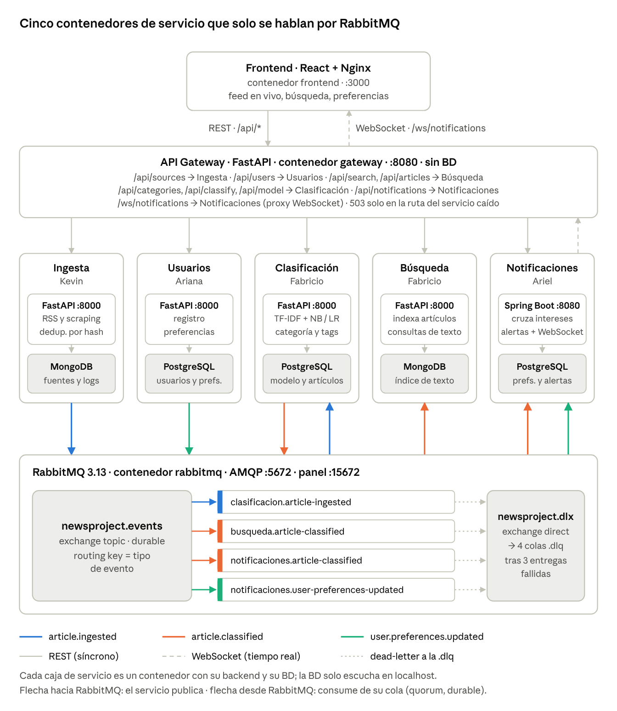

# newsproject — Agregador de Noticias

Agregador de noticias con microservicios (Sistemas Distribuidos, UNL). Ingesta obtiene artículos de fuentes RSS y sitios web, Clasificación les asigna categoría con TF-IDF + un clasificador de scikit-learn, Búsqueda los indexa y Notificaciones avisa en tiempo real a cada usuario según sus preferencias. Los servicios solo se comunican por eventos en RabbitMQ.

- Arquitectura completa: [`docs/arquitectura.md`](docs/arquitectura.md)
- Contrato de eventos: [`docs/eventos.md`](docs/eventos.md) — **léanlo antes de programar**



## Servicios

Cada microservicio de negocio es **un contenedor con su backend y su base de datos dentro**. La BD solo escucha en `localhost`, así ningún otro servicio puede leerla.

| Servicio | Carpeta | Responsable | Tecnología | Base de datos (mismo contenedor) | Publica | Consume |
|---|---|---|---|---|---|---|
| Ingesta | `ingesta/` | Kevin | Python · FastAPI | MongoDB | `article.ingested` | — |
| Clasificación | `clasificacion/` | Fabricio | Python · FastAPI · scikit-learn | PostgreSQL | `article.classified` | `article.ingested` |
| Búsqueda | `busqueda/` | Fabricio | Python · FastAPI | MongoDB | — | `article.classified` |
| Usuarios | `usuarios/` | Ariana | Python · FastAPI | PostgreSQL | `user.preferences.updated` | — |
| Notificaciones | `notificaciones/` | Ariel | Java 21 · Spring Boot | PostgreSQL | — | `article.classified`, `user.preferences.updated` |
| API Gateway | `gateway/` | Ariana | Python · FastAPI | — | — | — |
| Frontend | `frontend/` | Todos | React · Vite · Nginx | — | — | — |

## Requisitos

- Docker y Docker Compose v2 (`docker compose version`)
- Git

## Cómo levantar todo

```bash
git clone https://github.com/YooneR1209/newsproject.git
cd newsproject
cp .env.example .env          # luego cambia las claves dentro de .env
docker compose up -d --build
```

La primera vez tarda varios minutos porque construye las imágenes. Al terminar:

| Recurso | Dirección |
|---|---|
| Frontend | http://localhost:3000 |
| API Gateway | http://localhost:8080 (por ejemplo `http://localhost:8080/health`) |
| Panel de RabbitMQ | http://localhost:15672 (usuario y clave del `.env`) |
| RabbitMQ (AMQP, solo desarrollo) | `localhost:5672` |

### Verificar que todo está bien

```bash
docker compose ps -a
```

- Los servicios `ingesta`, `clasificacion`, `busqueda`, `usuarios`, `notificaciones`, `gateway` y `rabbitmq` deben aparecer como `healthy`.
- `newsproject-rabbitmq-init` debe aparecer como `Exited (0)`: corre una vez para cargar las colas y termina.

```bash
docker logs newsproject-rabbitmq-init                                  # termina con "Definiciones importadas"
docker exec newsproject-rabbitmq rabbitmqctl list_queues name type     # 8 colas quorum
```

### Entrar a la base de datos de un servicio

Las BD no publican puertos; se entra desde su contenedor:

```bash
docker exec -it newsproject-clasificacion psql -U <CLASIFICACION_DB_USER> clasificacion
docker exec -it newsproject-ingesta mongosh -u <INGESTA_DB_USER> -p <INGESTA_DB_PASS>
```

## Cómo trabajar en tu servicio

Cada carpeta trae una **plantilla base** que ya funciona dentro del `docker compose` y solo responde `GET /health`. Reemplázala por tu implementación sin cambiar la estructura:

| Archivo | Para qué sirve |
|---|---|
| `Dockerfile` | Imagen con tu backend y tu BD (PostgreSQL o MongoDB) |
| `supervisord.conf` | Arranca dos procesos: `db` (la BD, solo en localhost) y `api` (tu backend) |
| `app/main.py` o `src/...` | Tu código; ya tiene el endpoint `/health` |

Reglas para todos los servicios:

1. Tu backend lee `DATABASE_URL` y `RABBITMQ_URL` (o las variables `SPRING_*` en Notificaciones) del entorno; no escribas credenciales en el código.
2. Reintenta la conexión a la BD y a RabbitMQ al arrancar: la BD puede tardar unos segundos en estar lista.
3. `/health` debe responder 200 solo cuando la BD y RabbitMQ estén conectados.
4. Sigue el contrato de `docs/eventos.md`: `ack` manual, idempotencia por `article_id` o `user_id`, y `nack` para enviar a la `.dlq`.
5. Ningún servicio llama a otro por REST; solo publica o consume eventos.

Para probar tu servicio fuera de Docker (por ejemplo con `uvicorn --reload`), levanta solo el broker con `docker compose up -d rabbitmq rabbitmq-init`; el puerto 5672 se publica desde `docker-compose.override.yml`.

## Flujo de trabajo con Git

- Cada integrante trabaja en su rama: `kevin-dev`, `fabricio-dev`, `ariana-dev`, `ariel-dev`.
- Antes de empezar, trae lo último de `main`: `git checkout <tu-rama> && git merge main`.
- Los cambios llegan a `main` por pull request revisado por otro integrante.
- Antes de cada merge, `docker compose up -d --build` debe levantar el sistema completo.
- Los contratos de eventos y de REST solo cambian por pull request aprobado por los cuatro.
- Un solo release al final: `v1.0`. No se crean releases intermedios.

## Problemas comunes

**Las colas no son de tipo quorum o `rabbitmq-init` falla.**
Una cola existente no cambia de tipo. Si ya habías levantado la versión anterior, borra los volúmenes (se pierden los datos locales):

```bash
docker compose down -v
docker compose up -d --build
```

**Un servicio queda en `unhealthy`.**
Revisa sus logs: `docker compose logs -f <servicio>`. En los logs aparecen los dos procesos (`db` y `api`).

**Error de puerto ocupado (3000, 8080, 5672, 15672).**
Detén el programa que usa ese puerto o cambia el puerto de la izquierda en `docker-compose.yml` (por ejemplo `"8081:8000"`).

**RabbitMQ aparece como no saludable justo después de arrancar.**
Espera 20 a 30 segundos la primera vez y vuelve a ejecutar `docker compose ps -a`.

## Comandos útiles

```bash
docker compose up -d --build        # construir y levantar todo
docker compose logs -f <servicio>   # ver logs
docker compose stop <servicio>      # detener un servicio (prueba de tolerancia a fallos)
docker compose start <servicio>     # volver a iniciarlo
docker compose down                 # detener (conserva datos)
docker compose down -v              # detener y borrar datos
```
